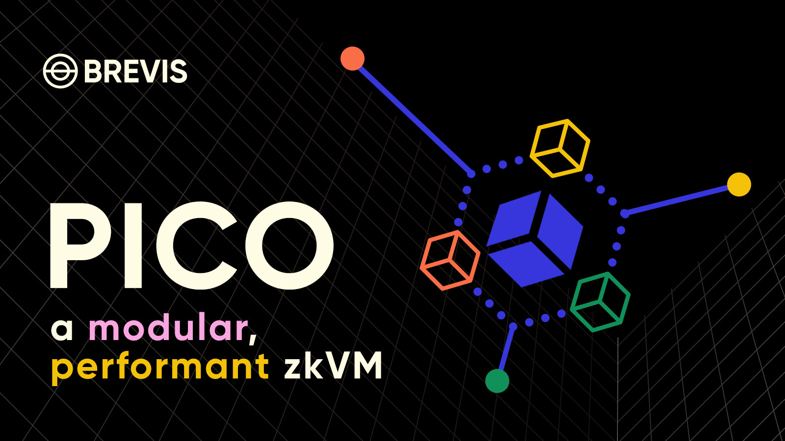

# Pico

Pico is an open-source zero-knowledge virtual machine (zkVM) that transforms how developers build secure, scalable, and high-performance decentralized applications. Drawing on the innovative [Glue-and-Coprocessor](https://vitalik.eth.limo/general/2024/09/02/gluecp.html) architecture, Pico fuses the efficiency of specialized circuits with the adaptability of a general-purpose zkVM. This unique design empowers you to craft tailored proof systems that meet the diverse needs of your applications.

**[Install](https://pico-docs.brevis.network/getting-started/installation)**
| [Docs](https://pico-docs.brevis.network/)
| [Examples](./examples)
| [Telegram](https://t.me/brevisnetwork)
| [Discord](https://discord.com/invite/QTRkjKdZ6A)

## Getting Started

Before you begin, please ensure that you have installed all the [requirements](./docs/requirements.md). For installation and setup instructions, refer to the [Installation Guide](https://pico-docs.brevis.network/getting-started/installation) and follow the steps outlined in [Quick Start](https://pico-docs.brevis.network/getting-started/quick-start) section in [Pico Docs](https://pico-docs.brevis.network/).

## Key Features
Pico's design is rooted in the need for adaptable, high-performance ZK systems that can keep up with the rapidly evolving cryptography research. Rather than relying on a "one size fits all" solution, Pico's modular architecture lets you:

- **Integrate App-Specific Circuits**: Seamlessly incorporate specialized circuits/coprocessors to accelerate domain-specific computations.
- **Customize Proving Workflows**: Assemble and fine-tune proof generation pipelines tailored to your application's specific requirements.

## Proof System
Pico 3.0 proves with a multilinear (MLE) STARK on the KoalaBear field (prime $p = 2^{31} - 2^{24} + 1$): LogUp-GKR for lookups, ZeroCheck for constraints and WHIR as the polynomial commitment. A proof runs through [five phases](https://pico-docs.brevis.network/writing-apps/advanced/proverchain) — RISCV → CONVERT → COMBINE → EMBED → WRAP — and the WRAP output is proved with Groth16 on BN254 for on-chain verification.

Pico 3.0 is a breaking release: 2.x proofs, keys and verifier contracts do not carry over. See the [release notes](./docs/release-notes/3.0.md), the [migration guide](./docs/migration-2.x-to-3.0.md) and the [support matrix](./docs/support-matrix.md).

## GPU Prover
Pico also has a GPU prover for the RISCV, CONVERT and COMBINE phases. It proves the same proof system with the same parameters, verifying-key whitelist and verifier contracts as 3.0, and its proofs verify with the CPU verifier.

The default build is the CPU prover and needs no CUDA Toolkit or GPU, on Linux and macOS. The GPU prover is the `cuda` feature (`cargo build --release --features pico-vm/cuda,distributed-vm/cuda`) and needs the CUDA Toolkit on x86-64 Linux to build and an NVIDIA GPU to run; a `cuda` build does not fall back to the CPU. `make build` and the `*_mle.sh` launchers pick the GPU build when they find `nvcc` and a GPU; `PICO_CUDA=0` or `PICO_CUDA=1` overrides that (see [`detect_cuda.sh`](./detect_cuda.sh)). The `cuda` feature pulls in the CUDA kernels from [pico-gpu](https://github.com/brevis-network/pico-gpu), which is licensed under BUSL-1.1. See the [support matrix](./docs/support-matrix.md).

## Security
Pico 3.0 targets 100 bits of provable round-by-round soundness under the random-oracle model, through the recursion root; the on-chain Groth16 step is held to BN254's security level. This is a computed bound, not a formal verification.

The verifier in [`contracts/test/dev`](./contracts/test/dev) comes from a test setup: a deployment needs keys and a verifier from a real setup ceremony.

A security review of Pico 2.x by Sherlock is available in [`audits/`](./audits); it predates and does not cover the 3.0 proof system.

## For Contributors

We welcome contributions from developers, researchers, and enthusiasts. Your input is crucial for Pico's evolution, whether you're fixing bugs, enhancing performance, improving documentation, or adding new features.

Before getting started, please review our [Repo Layout](./docs/layout.md) to understand the repository structure. For detailed contribution instructions, see our [Contributing Guidelines](./docs/contributor.md).

## Acknowledgements

Pico draws inspiration from the following projects, each representing cutting-edge advancements in zero-knowledge proof systems. 
- [Plonky3](https://github.com/Plonky3/Plonky3): Pico's proving backend is built on Plonky3's field, hash and matrix primitives.
- [SP1](https://github.com/succinctlabs/sp1): Pico derives significant inspiration from SP1's chip design and their constraints. Its recursion compiler and precompiles originate from SP1.
- [Valida](https://github.com/valida-xyz/valida): Pico's implementation of cross-table lookups is inspired by Valida's pioneering work in this area.
- [RISC0](https://github.com/risc0/risc0): Pico's Rust toolchain is based on the one originally developed by RISC0.
- [OpenVM](https://github.com/openvm-org/openvm): Pico's multilinear proving backend (LogUp-GKR, stacked reduction and WHIR) is based on OpenVM's stark-backend.
